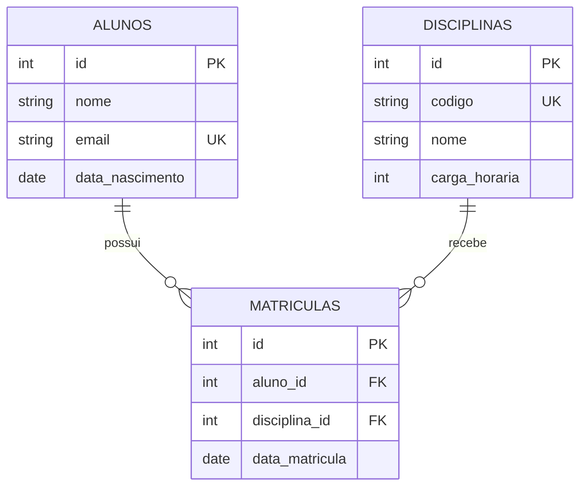

# API de Gerenciamento Acadêmico

API REST para gerenciar **alunos**, **disciplinas** e **matrículas**, construída com FastAPI, SQLAlchemy e PostgreSQL. O projeto simula o núcleo de um pequeno sistema acadêmico e foi feito para praticar boas práticas de back-end em Python: validação de dados, regras de negócio, migrações de banco e organização em camadas.

## Tecnologias

- **Python 3.12**
- **FastAPI**: criação da API e documentação interativa automática (Swagger)
- **Pydantic**: validação e serialização dos dados de entrada e saída
- **SQLAlchemy 2**: ORM e acesso ao banco
- **PostgreSQL 16**: banco de dados relacional
- **Alembic**: migrações do banco
- **Docker Compose**: banco de dados em container
- **Ruff**: lint e formatação do código

## Funcionalidades

### Alunos
- Cadastrar, listar (com paginação), buscar por ID, atualizar e excluir
- E-mail único e validado

### Disciplinas
- Cadastrar, listar (com paginação), buscar por ID, atualizar e excluir
- Código único e carga horária maior que zero

### Matrículas
- Matricular um aluno em uma disciplina
- Listar, consultar por ID e remover matrículas
- Não permite matricular o mesmo aluno duas vezes na mesma disciplina

## Regras de negócio e respostas da API

| Situação | Resposta |
|---|---|
| Recurso criado com sucesso | `201 Created` |
| Recurso removido com sucesso | `204 No Content` |
| Aluno, disciplina ou matrícula não encontrados | `404 Not Found` |
| E-mail de aluno ou código de disciplina já cadastrados | `409 Conflict` |
| Matrícula repetida (mesmo aluno e mesma disciplina) | `409 Conflict` |
| Dados inválidos (e-mail mal formatado, carga horária menor ou igual a zero, ids inválidos) | `422 Unprocessable Entity` |

Ao excluir um aluno ou uma disciplina, as matrículas ligadas a eles também são removidas.

## Endpoints

| Método | Rota | Descrição |
|---|---|---|
| `POST` | `/alunos/` | Cadastra um aluno |
| `GET` | `/alunos/` | Lista alunos (`skip` e `limit`) |
| `GET` | `/alunos/{aluno_id}` | Busca um aluno |
| `PATCH` | `/alunos/{aluno_id}` | Atualiza campos de um aluno |
| `DELETE` | `/alunos/{aluno_id}` | Exclui um aluno |
| `POST` | `/disciplinas/` | Cadastra uma disciplina |
| `GET` | `/disciplinas/` | Lista disciplinas (`skip` e `limit`) |
| `GET` | `/disciplinas/{disciplina_id}` | Busca uma disciplina |
| `PATCH` | `/disciplinas/{disciplina_id}` | Atualiza campos de uma disciplina |
| `DELETE` | `/disciplinas/{disciplina_id}` | Exclui uma disciplina |
| `POST` | `/matriculas/` | Matricula um aluno em uma disciplina |
| `GET` | `/matriculas/` | Lista matrículas (`skip` e `limit`) |
| `GET` | `/matriculas/{matricula_id}` | Busca uma matrícula |
| `DELETE` | `/matriculas/{matricula_id}` | Remove uma matrícula |

Com a API rodando, a documentação interativa completa fica em `http://127.0.0.1:8000/docs`.

### Exemplo de uso

Cadastrar um aluno:

```json
POST /alunos/
{
  "nome": "Maria Silva",
  "email": "maria@email.com",
  "data_nascimento": "2000-10-16"
}
```

Cadastrar uma disciplina:

```json
POST /disciplinas/
{
  "codigo": "MAT101",
  "nome": "Cálculo I",
  "carga_horaria": 60
}
```

Matricular o aluno na disciplina:

```json
POST /matriculas/
{
  "aluno_id": 1,
  "disciplina_id": 1
}
```

## Modelo de dados



Cada par (`aluno_id`, `disciplina_id`) é único na tabela de matrículas.

## Estrutura do projeto

```
.
├── alembic/              # migrações do banco
├── src/app/
│   ├── core/             # configurações (variáveis de ambiente)
│   ├── db/               # conexão e sessão do banco
│   ├── routers/          # endpoints (alunos, disciplinas, matriculas)
│   ├── schemas/          # modelos Pydantic de entrada e saída
│   ├── deps.py           # dependências compartilhadas (sessão do banco)
│   ├── main.py           # criação da aplicação
│   └── models.py         # tabelas (SQLAlchemy)
├── compose.yaml          # PostgreSQL em container
├── alembic.ini
├── pyproject.toml        # configuração do Ruff
└── requirements.txt
```

## Como rodar localmente

**Pré-requisitos:** Python 3.12, Docker e Git.

1. Clone o repositório:

```bash
git clone https://github.com/joaodamascenojr/api-gerenciamento-academico.git
cd api-gerenciamento-academico
```

2. Crie e ative o ambiente virtual:

```bash
python -m venv .venv

# Windows (PowerShell)
.\.venv\Scripts\Activate.ps1

# Linux/macOS
source .venv/bin/activate
```

3. Instale as dependências:

```bash
pip install -r requirements.txt
```

4. Crie o arquivo `.env` a partir do exemplo:

```bash
# Windows (PowerShell)
Copy-Item .env.example .env

# Linux/macOS
cp .env.example .env
```

5. Suba o banco de dados:

```bash
docker compose up -d
```

6. Aplique as migrações:

```bash
alembic upgrade head
```

7. Inicie a API:

```bash
uvicorn app.main:app --reload --app-dir src
```

Acesse `http://127.0.0.1:8000/docs` para testar os endpoints.

## Próximos passos

- [ ] Testes automatizados com pytest
- [ ] Notas e situação do aluno (aprovado ou reprovado)
- [ ] Autenticação com JWT e usuários (alunos e professores)
- [ ] Execução da API em container
- [ ] Integração contínua com GitHub Actions

## Autor

**João Damasceno**
[GitHub](https://github.com/joaodamascenojr) · [LinkedIn](https://www.linkedin.com/in/joaodamascenojr)
